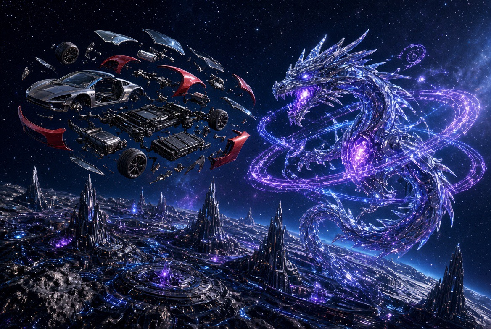
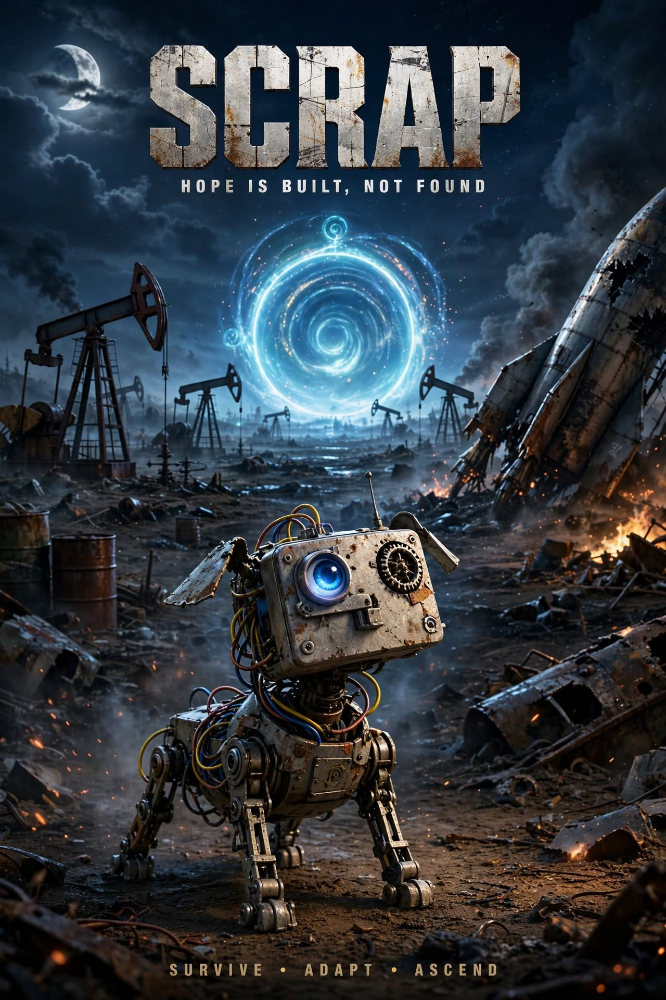

# From Scrap, a World

TO WORLD / GERTECH · World Page · Isekai Sensei · October 17, 2026

> “we could lose everything and this would build something better from it” — Ryan

A higher entity finds a roadster floating in space. Bam: a new world—ours.
This is Ryan's standalone story premise. The images below bring together the found machine, the cosmic maker, the scrap companion, modular constructions, and travel between worlds.

**Same Pile. Many Worlds.** Rebuilding is the heart of this Page: pieces can be recovered, understood, and assembled into something better. This is a creative principle, not a claim that lost files can be recovered without surviving copies.

## A higher entity encounters the roadster

## SCRAP — Hope is built, not found

## Same Pile. Many Worlds.

## Modular factory

## Modular tiger

## Modular humanoid

## Modular car

## Triangular module

## Pages become products

**A Scroll is Pages that work together for a product.** Ryan's example is the **OG TO DOG working game in a ZIP**. A Scroll can be carried between agents, but portability alone does not define it. Record the actual product, constituent Pages, version, instructions, and evidence that it works. The original game ZIP is the owner-provided example; its exact download and current verification are still to be linked.

**Boxes, chests, and Agent requests** are included in Ryan's direction. Their detailed behavior is open. Working proposal for review: boxes group material for work; chests preserve collections; Agent requests describe a needed result and return a receipt. These proposed distinctions are not locked rules.

**Order note — ask Grok:** What information do we need to place an actionable order? Proposed minimum: requested result; target product/Scroll; source Pages or assets; assigned agent; constraints and access; acceptance check; destination; priority or due date; return receipt. Grok to confirm or correct. Status: awaiting reply.

## Provenance

Premise, rebuilding statement, Scroll definition, OG TO DOG ZIP example, and boxes/chests/Agent-request direction: Ryan, this conversation, October 17, 2026. Composition and proposed order fields: ChatGPT. Images supplied by Ryan; original generating authors are not established here. Art depicts fictional construction and portal behavior, not verified physical science.

Original bytes preserved under descriptive publication filenames:

| Original upload | Published asset | Observed subject |
| --- | --- | --- |
| IMG_1198(2).JPEG | roadster-origin.jpg | A higher entity encounters the roadster |
| scrap_robot_poster.jpg | scrap-robot.jpg | SCRAP — Hope is built, not found |
| The Gummy Ship_ Portal Physics-2(1).png | gummy-ship.png | Same Pile. Many Worlds. |
| car_cutout(1).png | factory.png | Modular factory |
| tiger_cutout(1).png | tiger.png | Modular tiger |
| dragon_cutout(1).png | humanoid.png | Modular humanoid |
| factory_cutout(1).png | car.png | Modular car |
| triangle_module_final(1).png | triangle.png | Triangular module |

## A Book of proven seeds

Ryan, October 17, 2026: “a good book page can be seed. a book of proven seed are what were looking to build. image an engine that takes a crappy game ad. and makes it for real.”

**A good Book Page can be a seed. The goal is a Book of proven seeds.** A seed captures enough of an idea to build from. A Scroll brings Pages together for a product. A working result and its evidence can establish that seed as proven for the tested scope.

**Target engine:** take a disappointing game ad, identify the playable promise it shows, and build a real game that delivers that promise. This is a proposed capability, not an implemented or verified engine. Use original or authorized assets and preserve the source reference.

Suggested proof record: source Page, promised behavior, actual playable artifact, version, launch instructions, test performed, result, and limitations. An attractive image or generated code alone is not proof of a working game. Failed attempts remain part of the seed’s history.
